# order-platform-eks

I recently earned my AWS Certified Cloud Practitioner and AWS Certified Solutions Architect – Associate certifications. While working on projects, I noticed that most people build the same EKS project, so I wanted to do something different and more business-minded: an order-processing system for an online store, running on Amazon EKS.

I built it, load-tested it, broke it on purpose, and tore it down again on my own AWS account. All the numbers in this README come from those tests and runs.

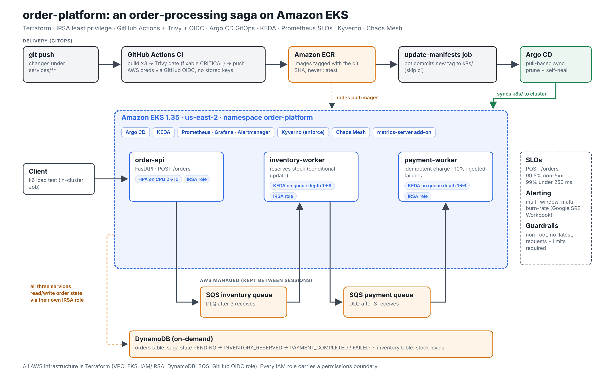

## Highlights

| Area | Result |
|---|---|
| **Load** | 127,109 orders in a 13-minute k6 run (up to 150 virtual users), **0% errors**, median 42 ms, p95 295 ms |
| **Autoscaling** | order-api scales on CPU (HPA, 2 to 10 pods); both workers scale on **SQS queue depth** (KEDA, 1 to 6 pods) |
| **Delivery** | `git push` → build → Trivy gate → ECR (tagged by git SHA) → bot commit → Argo CD sync. No one runs `kubectl` to deploy, and CI holds no cluster credentials |
| **Security** | GitHub OIDC (no stored AWS keys), one IRSA role per service, permissions boundary on every role, Kyverno blocks non-compliant pods |
| **Observability** | Two SLOs on `POST /orders` with multi-window burn-rate alerts, 22 recording and alerting rules validated and unit-tested with `promtool`, 21-panel Grafana dashboard as code |
| **Chaos** | Killed worker pods under load: **0 of 31,390 orders lost**, API stayed at 100% availability. Simulated a bad IAM change: the SLO alert paged in about 3 minutes |

## Contents

- [Architecture](#architecture)
- [Tech stack](#tech-stack)
- [Repository layout](#repository-layout)
- [Infrastructure and IAM](#infrastructure-and-iam)
- [The services and how they stay correct](#the-services-and-how-they-stay-correct)
- [CI: build, scan, push](#ci-build-scan-push)
- [GitOps with Argo CD](#gitops-with-argo-cd)
- [Autoscaling: HPA and KEDA](#autoscaling-hpa-and-keda)
- [Observability and SLOs](#observability-and-slos)
- [Policy as code: Kyverno](#policy-as-code-kyverno)
- [Chaos engineering](#chaos-engineering)
- [Incident write-up: a bad IAM change](#incident-write-up-a-bad-iam-change)
- [Load test history](#load-test-history)
- [Findings and known gaps](#findings-and-known-gaps)
- [Problems I hit and how I solved them](#problems-i-hit-and-how-i-solved-them)
- [Cost](#cost)
- [Running it](#running-it)
- [What I would do next](#what-i-would-do-next)

## Architecture

Three Python (FastAPI / boto3) services pass an order along a saga. They share no code and talk only through SQS messages and DynamoDB state.

1. **order-api** validates `POST /orders`, writes the order to DynamoDB as `PENDING`, and publishes to the inventory queue.
2. **inventory-worker** long-polls that queue, reserves stock for every line item, and hands off to the payment queue.
3. **payment-worker** long-polls the payment queue, runs a simulated payment gateway (10% of charges fail on purpose), and writes the final status.

Order status: `PENDING → INVENTORY_RESERVED → PAYMENT_COMPLETED`, with `INVENTORY_FAILED` and `PAYMENT_FAILED` as the failure branches. Messages that a worker cannot process go to a dead-letter queue after 3 attempts.

## Tech stack

| Area | Tools (pinned versions) |
|---|---|
| Cloud | AWS us-east-2: EKS 1.35 (Amazon Linux 2023), VPC, DynamoDB (on-demand), SQS + DLQs, ECR, IAM |
| Infrastructure as code | Terraform 1.9, `terraform-aws-modules` for VPC/EKS, hand-written IAM, IRSA, DynamoDB, SQS |
| Services | Python, FastAPI, boto3, `prometheus-client`; multi-stage Dockerfiles, non-root (UID 10001) |
| CI | GitHub Actions, Trivy (`aquasecurity/trivy-action@v0.36.0`), GitHub OIDC to AWS |
| GitOps | Argo CD 3.4 (Helm chart 10.2.2) |
| Autoscaling | HPA + metrics-server (EKS add-on), KEDA 2.21 |
| Observability | kube-prometheus-stack 91.8.1 (Prometheus, Grafana, Alertmanager) |
| Policy | Kyverno 1.19 (`ValidatingPolicy`, CEL) |
| Chaos | Chaos Mesh 2.8.4, plus an IAM-based fault |
| Load testing | k6 2.3.0, run as an in-cluster Kubernetes Job |

## Repository layout

```
.github/workflows/ci.yml   build -> Trivy -> ECR push, then bump image tags in k8s/
services/<svc>/            app code + Dockerfile for order-api, inventory-worker, payment-worker
k8s/                       everything Argo CD syncs (Deployments, HPA, ScaledObjects, monitors, SLO rules, dashboard)
argocd/                    the Argo CD Application (kept outside k8s/ so Argo CD doesn't manage itself)
terraform/                 VPC, EKS, IRSA roles, DynamoDB, SQS, KEDA role, GitHub OIDC role
iam/                       permissions boundary and Terraform-user policies (applied by an admin)
monitoring/                kube-prometheus-stack Helm values
kyverno/                   3 admission policies
chaos/                     chaos experiments (kept outside k8s/ so self-heal can't re-apply them)
load-test/                 k6 smoke test, load test, chaos-load profile, k6 Job manifest
```

## Infrastructure and IAM

All AWS infrastructure is in Terraform. The interesting part is the IAM model, which applies least privilege to the Terraform identity itself, not just to the workloads.

- A dedicated IAM user (`eks-terraform-cli`) can only create roles named `order-platform-*`, and only if the `order-platform-boundary` permissions boundary is attached. The boundary caps what any project role can do and denies all `iam:*`.
- The Terraform user is explicitly denied from editing or removing the boundary, so it cannot raise its own ceiling. Widening it (for example, to let CI push to ECR) is a deliberate admin change scoped to specific actions and repository ARNs.
- Each service gets its own IRSA role, scoped to its exact Kubernetes service account:
  - **order-api**: `PutItem`/`GetItem` on orders, `SendMessage` on the inventory queue.
  - **inventory-worker**: `UpdateItem` on both tables, receive/delete on the inventory queue, `SendMessage` on the payment queue.
  - **payment-worker**: `GetItem`/`UpdateItem` on orders, receive/delete on the payment queue, and **no `SendMessage` at all**. IAM, not just code, enforces that it is the end of the chain.
  - **KEDA operator**: only `sqs:GetQueueAttributes` on the two queues. The autoscaler can read queue depth but cannot read, send or delete messages.
- Every role carries the permissions boundary. Defense in depth: boundary (ceiling) + role policy (exact grants) + trust policy (who can assume it) + Trivy gate (what can be pushed).
- metrics-server is a Terraform-managed EKS add-on, so every fresh cluster comes up with it.

## The services and how they stay correct

SQS delivers at least once and pods can die at any moment, so correctness can't depend on things going smoothly.

- **No overselling.** Stock is decremented with a conditional DynamoDB update (`quantity_available >= requested`). Two pods racing on the same SKU cannot oversell, without locks or transactions.
- **All-or-nothing reservations.** If item N in an order fails, items already reserved are released before the order is marked `INVENTORY_FAILED`.
- **Idempotent payments.** payment-worker checks that the order is still `INVENTORY_RESERVED` before charging, then uses a conditional update so only the first writer wins. A redelivered message can't charge twice.
- **Failed messages aren't deleted.** They reappear after the 30 s visibility timeout and move to the DLQ after 3 receives.
- **Graceful shutdown.** Workers finish their current batch on SIGTERM; their grace period is 60 s because a worker may be mid long-poll plus mid-batch.
- **Hardened pods.** `runAsNonRoot`, numeric UID, seccomp `RuntimeDefault`, no privilege escalation, read-only root filesystem, all capabilities dropped. order-api has readiness and a deliberately more forgiving liveness probe.
- **Chaos-ready config.** The payment failure rate is a ConfigMap value, so failure paths can be turned up without rebuilding images.

## CI: build, scan, push

`.github/workflows/ci.yml` runs on pushes and pull requests that touch `services/**`.

- Builds all three images in parallel (matrix).
- Runs Trivy twice: once to upload HIGH/CRITICAL findings to the GitHub Security tab (informational), and once as a **gate that fails the build on any CRITICAL vulnerability with a fix available**, so those images never reach ECR.
- Tags images with the full git commit SHA. No `latest`, no reused tags, so every running pod traces back to an exact commit.
- Authenticates to AWS with **GitHub OIDC**. There are no long-lived keys in GitHub. The IAM role's trust policy only accepts this repository's `main` branch, so pull requests (including from forks) build and scan but never get AWS credentials.
- `GITHUB_TOKEN` permissions are least privilege at the job level: only the manifest-update job can write to the repo.

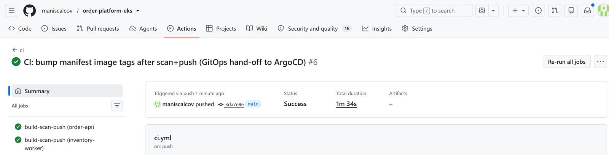

## GitOps with Argo CD

Argo CD runs in the cluster and keeps it matching the `k8s/` folder on `main`, with automated sync, prune and self-heal. CI never talks to the cluster.

The hand-off: after all three images pass the Trivy gate and land in ECR, the `update-manifests` job rewrites the image tags in `k8s/*/deployment.yaml` to the new SHA and commits as `github-actions[bot]`. Argo CD picks up the commit and rolls it out. The bot commit can't trigger another CI run, for three independent reasons: it only touches `k8s/` (outside the workflow's path filter), pushes made with `GITHUB_TOKEN` don't trigger workflows, and the message carries `[skip ci]`.

First end-to-end run: bot commit at 11:57:14, deployed by Argo CD's automated sync policy at 11:58:47.

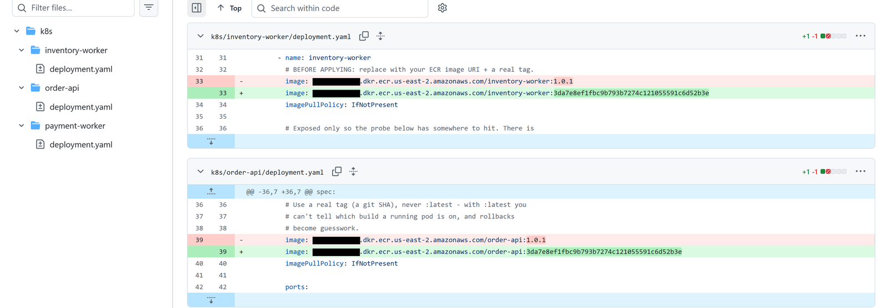

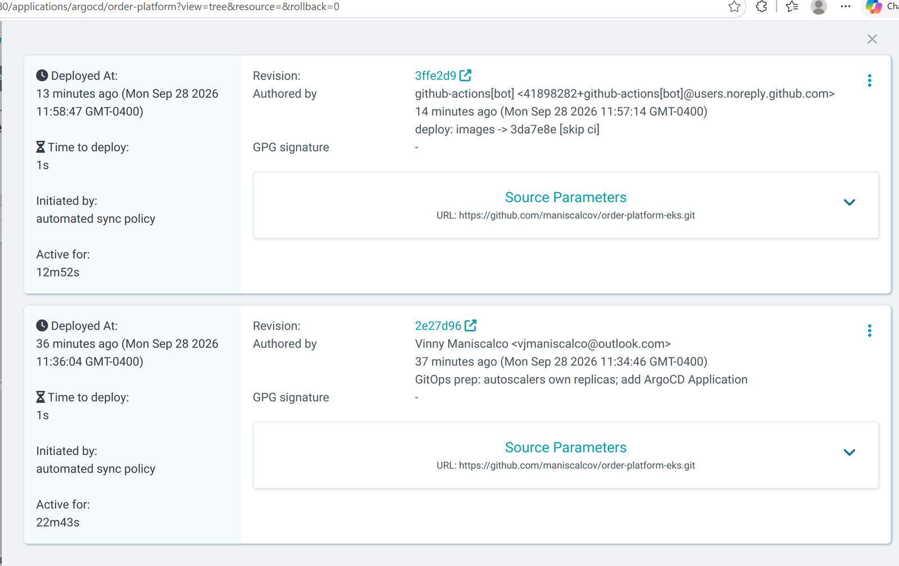

<details>
<summary>Argo CD resource tree (Synced / Healthy)</summary>

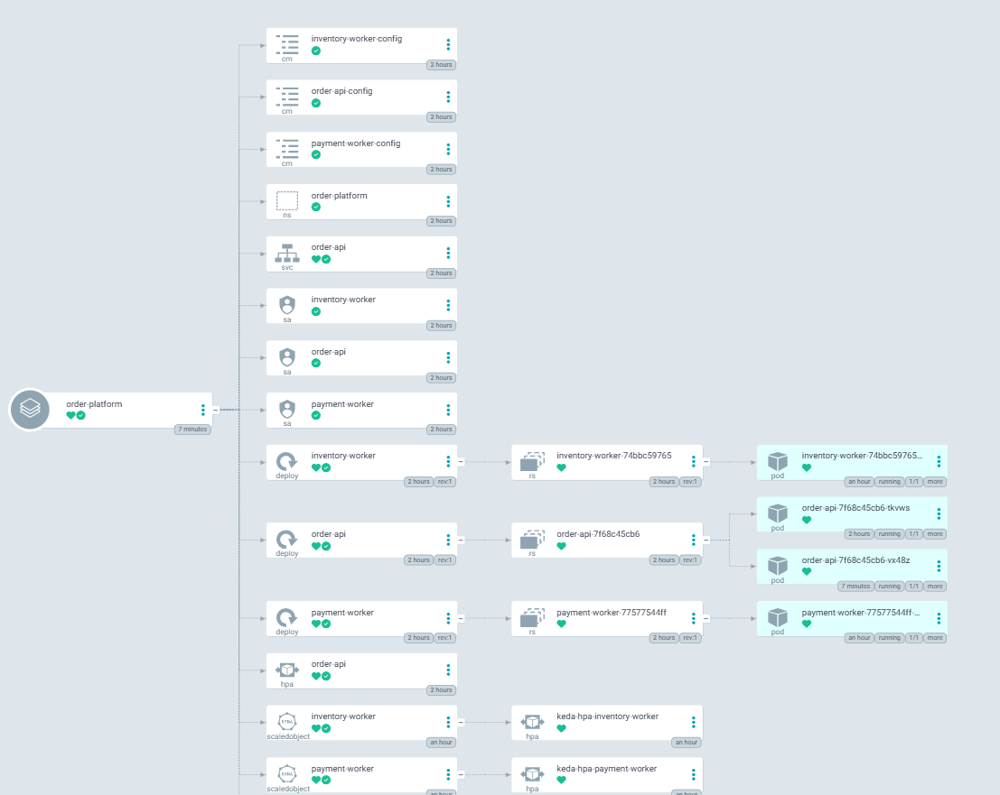
</details>

**Design decision:** I removed `replicas:` from all Deployments before enabling Argo CD. Otherwise self-heal (Git says 2) and the autoscalers (KEDA says 6) fight in a loop. The HPA and KEDA own replica counts.

## Autoscaling: HPA and KEDA

- **order-api** scales on CPU with an HPA (2 to 10 pods, target 70% of the CPU request). It scales up fast (can double every 30 s) and down slowly (5-minute stabilization, then 1 pod per minute) to avoid flapping. I removed the memory metric after load testing showed Python processes don't release memory after a spike, which kept replicas pinned above the floor.
- **The workers** scale on **SQS queue depth** with KEDA (1 to 6 pods, target 20 messages per pod). A worker blocked on a 20-second long-poll uses almost no CPU even while thousands of messages pile up, so a CPU-based HPA would scale *down* exactly when the backlog is worst.

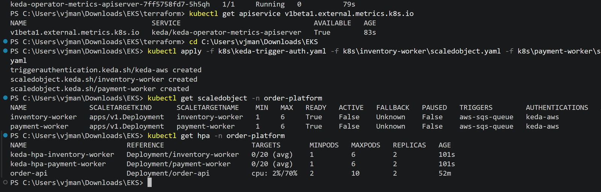

## Observability and SLOs

kube-prometheus-stack (Prometheus, Grafana, Alertmanager), with app metrics added to all three services through the normal CI/CD pipeline.

- **RED metrics** on order-api: requests by method, route template and status, plus a latency histogram with buckets around the 250 ms SLO. Routes use the path template (`/orders/{order_id}`) to avoid label explosion, and `/health`/`/metrics` are excluded so probes can't inflate the SLI.
- **Saga metrics** on the workers: messages by outcome, processing time, reservations and payments by result, and integrity counters that make the idempotency guards visible (`payment_duplicates_skipped_total`, `payment_race_lost_total`).
- **SLOs on `POST /orders`:** availability 99.5% non-5xx, latency 99% under 250 ms.
- **Multi-window, multi-burn-rate alerts** (Google SRE Workbook): critical at 14.4x over 1h and 5m, or 6x over 6h and 30m; warning at 3x over 1d and 2h. Plus saga alerts: publish failures (orders stuck in `PENDING`), worker error ratio, payment failure rate above 20%, and lost payment races.
- Rules validated with `promtool check rules` and a `promtool test rules` unit test before deploying.
- The **Grafana dashboard is code** (a ConfigMap picked up by the Grafana sidecar), deployed by Argo CD like everything else.

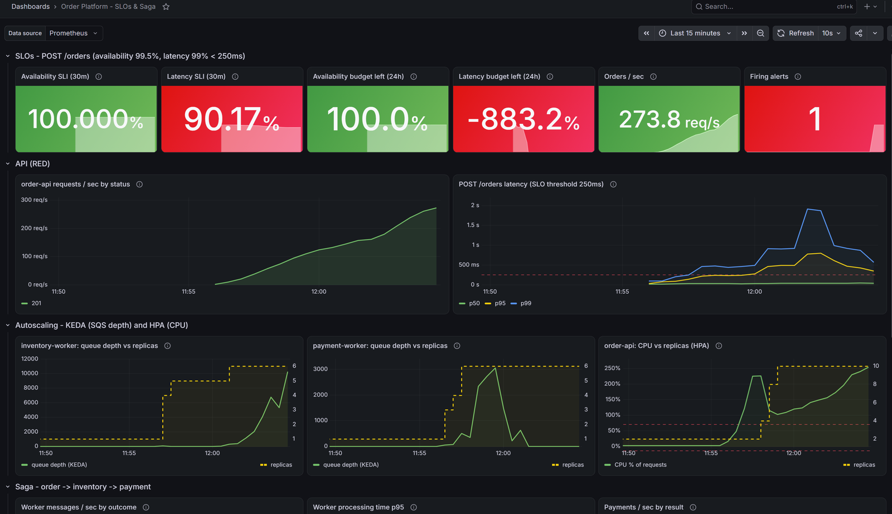

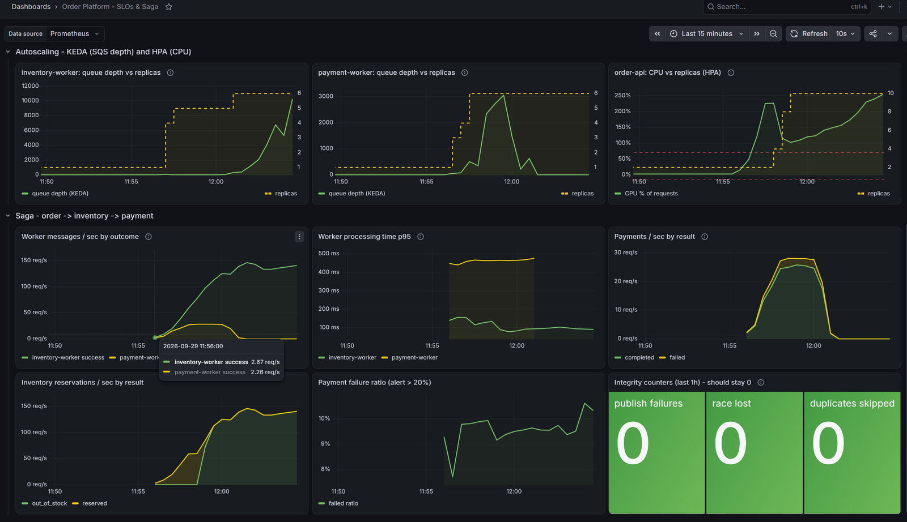

Monitoring design choices worth calling out:

- No persistent volumes (emptyDir). The EBS CSI driver is installed, so PVCs would create EBS volumes that survive `terraform destroy` and keep billing.
- Prometheus selects ServiceMonitors and rules from any namespace, not just ones carrying the Helm release label, so the ones Argo CD deploys are picked up.
- etcd, scheduler, controller-manager and kube-proxy scrapes are disabled. AWS manages the EKS control plane, so they would be permanent false "target down" alerts.
- Memory limits but no CPU limits on monitoring components; CPU limits throttle Prometheus and silently delay scrapes.

## Policy as code: Kyverno

Three Kyverno `ValidatingPolicy` resources (CEL), scoped to the `order-platform` namespace and auto-generated for Deployments and Jobs:

- `require-run-as-non-root`
- `disallow-latest-tag` (accepts version tags or `@sha256` digests)
- `require-requests-limits` (CPU and memory requests **and** limits)

I ran them in **Audit** mode first. The PolicyReport showed every app Deployment already passing all 3; the only violation was the k6 load-test Job using `grafana/k6:latest`. I pinned it to `2.3.0`, then switched to **Enforce**. A test pod using `nginx:latest` was rejected by the admission webhook for all three reasons:

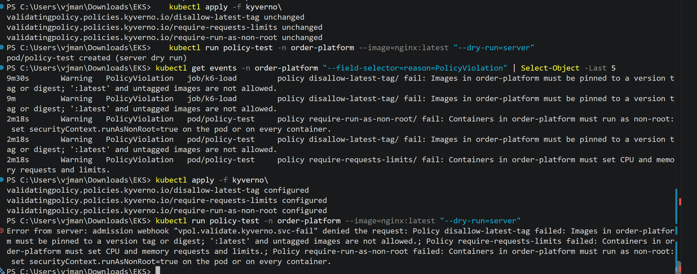

<details>
<summary>Audit-mode PolicyReport (only the k6 Job failed)</summary>

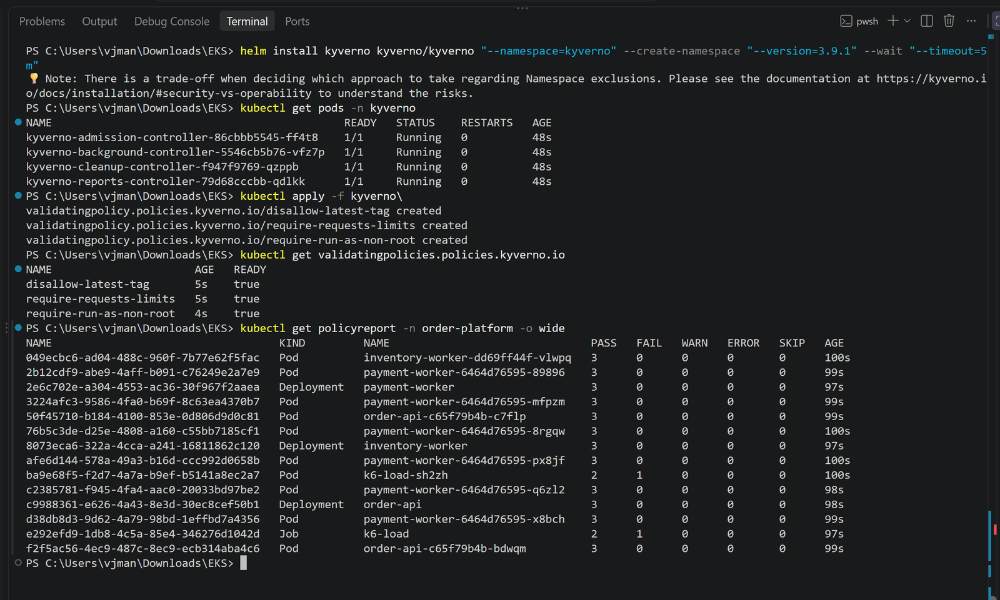
</details>

With Argo CD in front, this also guards GitOps: a merged manifest using `:latest` fails at admission and never runs.

## Chaos engineering

Each experiment had its hypotheses written down **before** the run, and I report the ones that weren't confirmed.

### Experiment 1: SIGKILL worker pods under load

A Chaos Mesh schedule killed a random inventory-worker or payment-worker pod every 2 minutes (grace period 0) for about 10 minutes, while k6 sent a steady ~20 orders/s.

| Hypothesis | Result |
|---|---|
| No orders are lost (unacknowledged SQS messages reappear after the visibility timeout) | **Confirmed.** 31,390 orders created, k6 count = DynamoDB count, 0 stuck in `PENDING`/`INVENTORY_RESERVED`, all queues and DLQs at 0 |
| Killed pods are replaced and the backlog drains | **Confirmed.** Inventory queue spikes of ~280 and ~130 messages each drained in about a minute |
| The API is unaffected | **Confirmed.** Availability 100%, latency SLI 99.95%, p99 flat at ~80 ms. The queue isolated customers from worker failures |
| Redelivery shows up as payment "duplicates skipped" > 0 | **Not observed** (stayed 0). That doesn't prove there was no redelivery: a duplicate payment message only occurs if an inventory-worker pod dies in the milliseconds between publishing to the payment queue and deleting its own message |

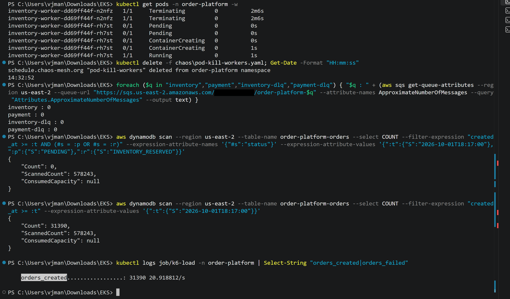

While writing the hypotheses I also found a real risk in the code: inventory-worker has **no idempotency check**, so a redelivered message could reserve stock twice (a stock leak, not a lost order). It's on the fix list.

### Experiment 2: a bad IAM change

See the write-up below.

## Incident write-up: a bad IAM change

**What I simulated:** someone attaches an inline `Deny dynamodb:PutItem` on the orders table to the order-api role, the kind of mistake a policy refactor can cause.

**Why IAM instead of a Chaos Mesh network fault:** I read the code path first. boto3 keeps pooled keep-alive connections, so DNS chaos would probably never trigger under steady load. A network partition causes 60-second timeouts and retries (a latency problem, not clean errors). HTTP chaos aborts requests in a proxy *before* they reach the app, so the app's own metrics, which the SLO is built on, would never see them. An explicit IAM Deny overrides every Allow, applies to existing sessions, and makes writes fail fast with real 500s.

**Timeline** (steady load of ~21 requests/s):

| Time | Event |
|---|---|
| 15:03:44 | Deny policy attached |
| 15:06:59 | Still 100% successful: IAM changes take time to propagate |
| ~15:08:30 | First 500s; by 15:08:39 every recent `POST` is a 500 |
| ~15:09 | `OrdersAvailabilityBudgetBurnCritical` pending (2-minute `for:`) |
| ~15:11 | **Critical alert firing**, about 3 minutes after the first 500 |
| 15:15:51 | Deny policy removed |
| ~15:17 to 15:20 | Success returns gradually (mixed 201/500 for ~3 minutes) |
| ~15:24 | Slow-burn warning alert fires as well |

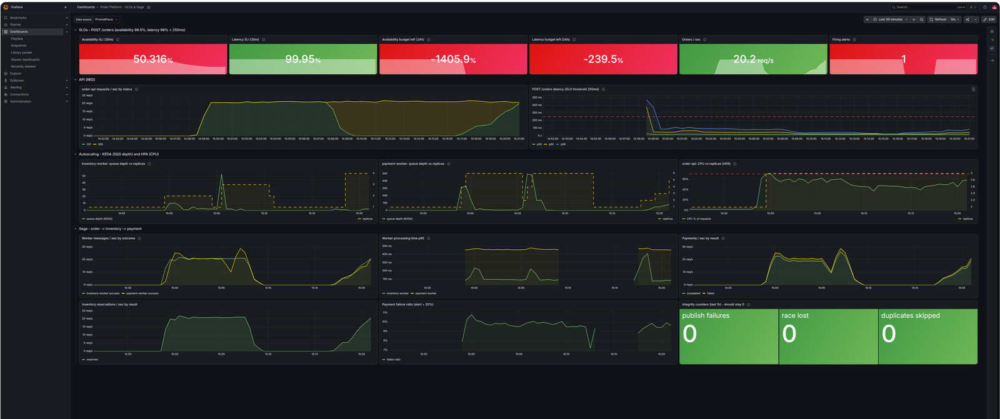

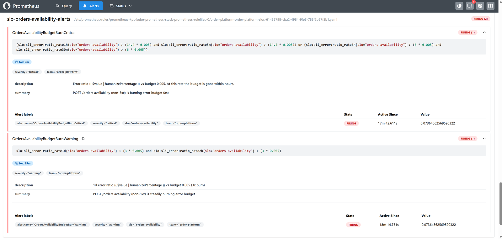

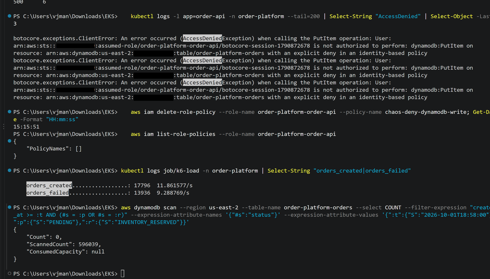

**Impact:** 17,796 orders created, 13,936 rejected (about 44% of the run). **0 half-written orders**: a failed `PutItem` means nothing was written or published, so there was nothing to clean up.

**What I learned:**
- **IAM changes took longer than I expected.** I added a Deny rule to break the system, and it took about 5 minutes to take effect instead of happening right away. When the count was still 97 out of 97 successful orders, I thought the change hadn't worked. After I removed the rule, it took another 2 to 4 minutes to gradually recover. So if someone accidentally made a bad change to an IAM policy, it could take a while to track down the cause. Next time, I'll check CloudTrail first to see if an IAM policy was changed recently.
- **Having two SLOs paid off.** Availability crashed while latency stayed green, because the requests failed fast. Looking at the dashboard, it was clear right away that this was an errors problem, not a slowness problem.
- **The alerting worked, but I'd tune it.** The critical alert paged in about 3 minutes, which is what I designed for. But it kept firing for about 30 minutes after I'd fixed the problem. Next time I'd also add an alert on `AccessDenied` in the logs, which would catch this kind of failure faster than the SLO.

## Load test history

All runs: k6 as an in-cluster Job, ramping to 150 virtual users over 13 minutes, against the order-api Service.

| Run | Orders | Errors | Median / p95 | Notes |
|---|---|---|---|---|
| Phase 2, via `kubectl port-forward` | 18,099 | 85.35% | n/a | Invalid: port-forward pins all traffic to one pod and the tunnel dropped |
| Phase 2, in-cluster | 140,993 | 0.00% | 21 ms / 90 ms | HPA scaled order-api 3 to 10 in ~90 s |
| Session 2 (+ KEDA) | 141,110 | 0.00% | 21 ms / 77 ms | Exposed the payment-worker throughput limit |
| Session 3 (+ observability) | 119,456 | 0.00% | 44 ms / 528 ms | Latency SLO alert fired; seed stock ran out ~2 min in (see findings) |
| Session 4 (stock fixed) | 127,109 | 0.00% | 42 ms / 295 ms | All k6 thresholds passed; latency SLI 95.0%, warning alert fired at 5x burn |

Same app, same cluster: moving the load generator inside the cluster took the test from 85% errors to 0% and about 8x the throughput. The bottleneck was the tunnel, not the app.

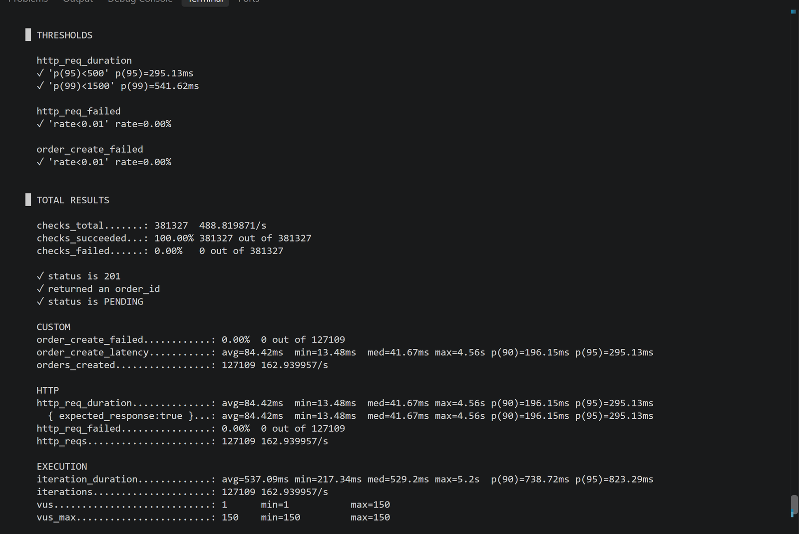

## Findings and known gaps

These came out of the load tests, dashboards and chaos runs. Some are fixed, some are deliberately left open and documented.

1. **Latency SLO breach caused by node CPU saturation (Session 3).** I tested two hypotheses. Pod CPU throttling spiked to 13.5% only during the ramp, before the HPA scaled, and stayed at 1 to 3% during the worst latency, so it was ruled out. Node CPU was at 95 to 100% on 2 of 3 nodes for about 8 minutes: confirmed. HPA and KEDA did their job but hit their caps; pod autoscaling can't create CPU. The fix is node autoscaling (Karpenter or Cluster Autoscaler).

   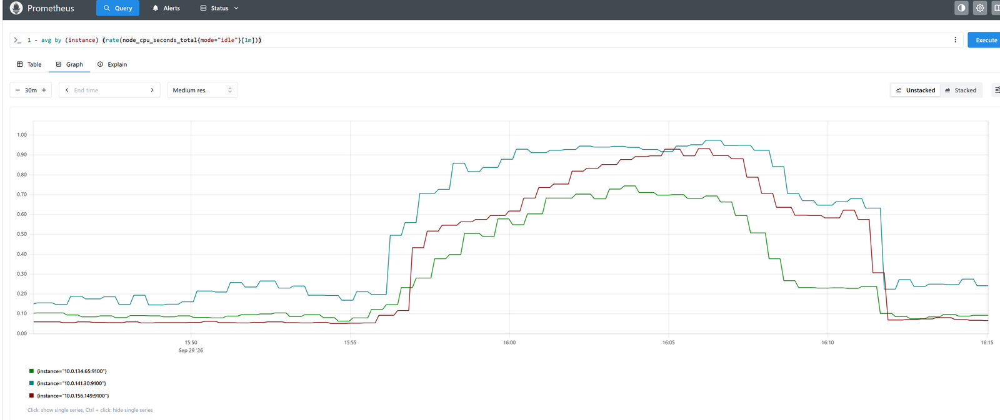

2. **A load test can quietly become invalid.** The dashboard showed seed stock running out about 2 minutes into the Session 3 run, after which most orders took the `out_of_stock` path. Earlier runs with the same 5,000-unit seed were probably affected too, unnoticed. I raised seed stock to 500,000 per SKU (with the math in a comment) and re-ran a valid baseline in Session 4.
3. **payment-worker has a hard throughput ceiling.** The simulated gateway takes 50 to 300 ms per charge (~175 ms average) and each pod processes one message at a time: about 5.7 messages/s per pod, about 34/s at KEDA's max of 6 pods, against ~163 orders/s of intake. The payment backlog peaked at 89,853 messages. The fix is concurrent processing inside the worker or a higher replica cap with more nodes, not more CPU.
4. **Saga gap:** a failed payment marks the order `PAYMENT_FAILED` but doesn't release the reserved stock (about 10% of orders leak inventory). Documented, not yet fixed.
5. **inventory-worker isn't idempotent** (found during chaos planning, see above).
6. **Write-then-publish gap:** if order-api writes the order but the SQS publish fails, the order stays `PENDING`. The `OrderPublishFailures` alert now covers it; a reconciliation job would close it.
7. **The p95 improvement between Session 3 and 4** isn't explained by the stock fix (with stock, workers do *more* work). From single runs, I treat it as run-to-run variance.

## Problems I hit and how I solved them

- **metrics-server pods were Running but the Metrics API was down.** The APIService showed `FailedDiscoveryCheck`. The EKS metrics-server add-on listens on port 10251, and the node security group from the EKS module didn't allow the control plane in on that port. Fixed with one security group rule in Terraform.

  <details>
  <summary>Before and after</summary>

  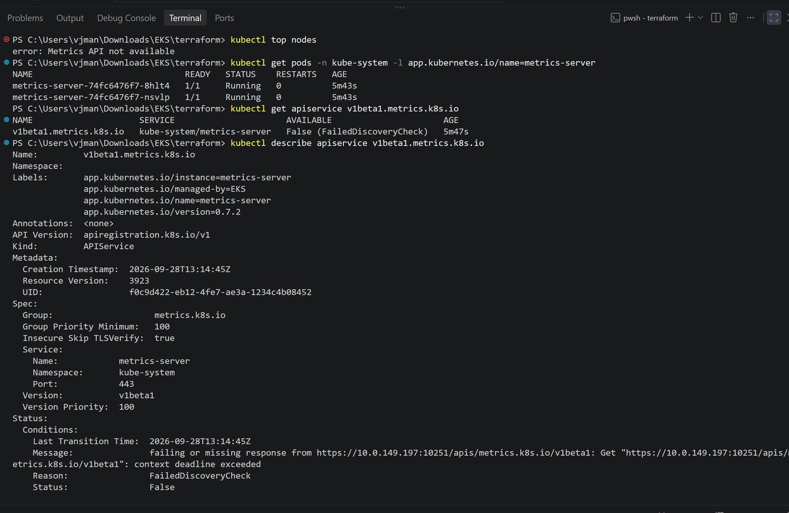
  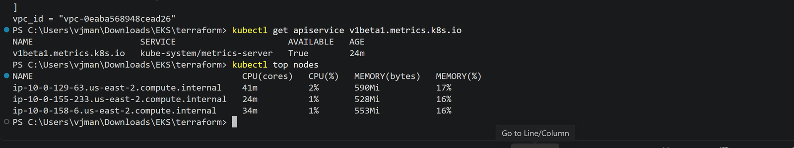
  </details>

- **GitHub OIDC was denied.** CloudTrail showed the exact subject claim GitHub sent: it now embeds immutable numeric owner and repo IDs, not just `owner/repo`. I updated the trust policy to match. Side benefit: a deleted-and-recreated repo with the same name can't inherit AWS access.
- **AccessDenied on `terraform apply`, for the wrong user.** The error named a different IAM user than the one whose policy I was editing: my default AWS CLI profile belonged to another project. What I learned: read the principal ARN in the error before touching any policy.
- **`terraform destroy` would have deleted my data.** The cluster and the DynamoDB tables share a state file, so I destroy with `-target=module.eks -target=module.vpc` and check the saved plan for DynamoDB or SQS resources before applying. I did this projects over the span of 2 weeks so to save money I used terraform to destory my cluster then re-apply it when I started doing it again. Before destroying I noticed there was some data that I did not want to delete in the cloud so I did this.

## Cost

- The EKS cluster and VPC are destroyed at the end of every work session and rebuilt with `terraform apply` next time. DynamoDB, SQS, ECR, IAM and the GitHub OIDC role are kept; they cost close to nothing while idle.
- No PersistentVolumes and no LoadBalancers (UIs are reached with `kubectl port-forward`), so nothing outlives the cluster.
- While running: 3x t3.large plus the control plane, roughly $0.35/hour.
- **Caught a silent 6x cost increase.** Kubernetes 1.32 had left EKS standard support, so the control plane was automatically billed at extended-support rates ($0.60/hour instead of $0.10). Because the cluster is fully reproducible, the fix was a one-line change to `cluster_version` and the next apply created a 1.35 cluster.
- Nodes were sized from pod-slot math, not just CPU: the VPC CNI limits a t3.medium to 17 pods, and the full stack needs about 56 pods at load-test peak. A t3.large allows 35 per node.

## Running it

This is a lab project, so this is the order I bring it up in rather than a polished installer.

1. **Prerequisites:** an AWS account, Terraform 1.9+, kubectl, Helm, Docker, and an admin-created permissions boundary and Terraform user (policies in `iam/`).
2. **Infrastructure:** copy `terraform/terraform.tfvars.example` to `terraform.tfvars`, fill in your values, then `terraform plan -out=tfplan` and `terraform apply tfplan`. Connect with `aws eks update-kubeconfig --region us-east-2 --name order-platform-eks`.
3. **Platform, in this order** (CRDs before the things that use them):

   | Component | Helm chart | Version |
   |---|---|---|
   | kube-prometheus-stack | `prometheus-community/kube-prometheus-stack` (values in `monitoring/kps-values.yaml`) | 91.8.1 |
   | KEDA | `kedacore/keda` with `podIdentity.aws.irsa.enabled=true` and the KEDA role ARN from Terraform outputs | 2.21.0 |
   | Argo CD | `argo/argo-cd` (Dex and notifications disabled) | 10.2.2 |
   | Kyverno | `kyverno/kyverno`, then `kubectl apply -f kyverno/` | 3.9.1 |
   | Chaos Mesh | `chaos-mesh/chaos-mesh` (only needed for experiments) | 2.8.4 |

4. **App:** `kubectl apply -f argocd/order-platform-app.yaml`. Argo CD syncs everything in `k8s/`.
5. **Test:** run `load-test/smoke-test.js` first, then the load test as an in-cluster Job (`load-test/k6-job.yaml`).
6. **Tear down:** destroy only the cluster and VPC: `terraform plan -destroy -target=module.eks -target=module.vpc -out=destroy.tfplan`, check the plan, then apply it.

## What I would do next

- Node autoscaling with Karpenter (the root cause of the Session 3 latency breach).
- Concurrent message processing in payment-worker.
- Idempotency in inventory-worker, and releasing stock on `PAYMENT_FAILED`.
- Remote Terraform state (S3 backend with locking).
- Pin GitHub Actions to full commit SHAs.
- Manage the Kyverno policies with Argo CD.

## More evidence

<details>
<summary>Trivy findings in the GitHub Security tab</summary>

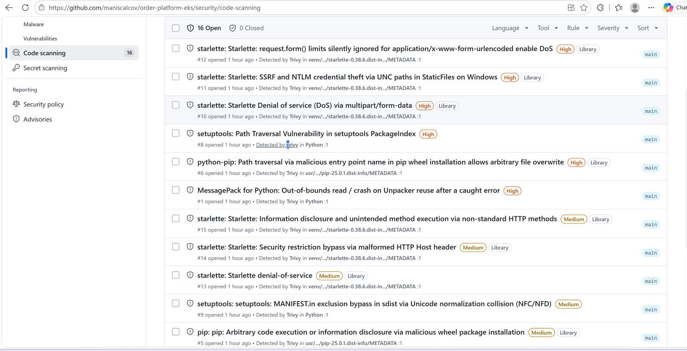
</details>

<details>
<summary>KEDA scaling the inventory worker on queue depth under load</summary>

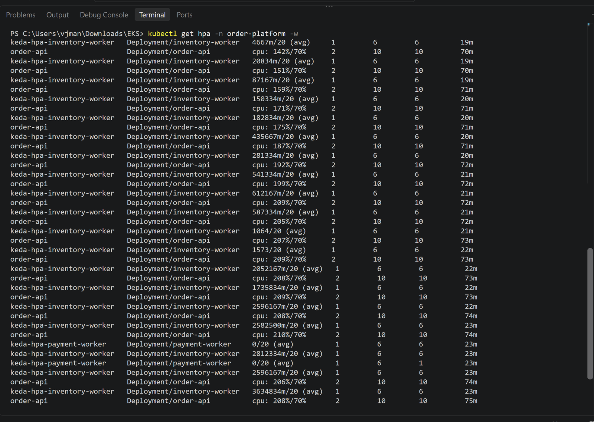
</details>

<details>
<summary>Port-forward run (85% errors) vs in-cluster run (0% errors)</summary>

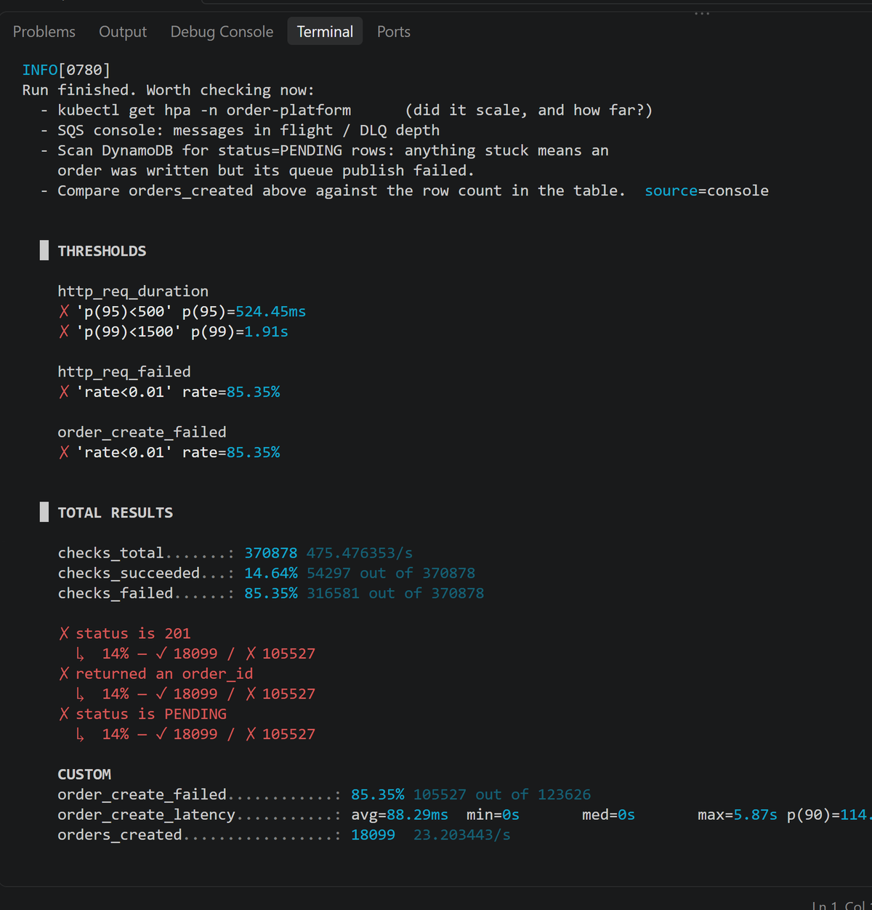
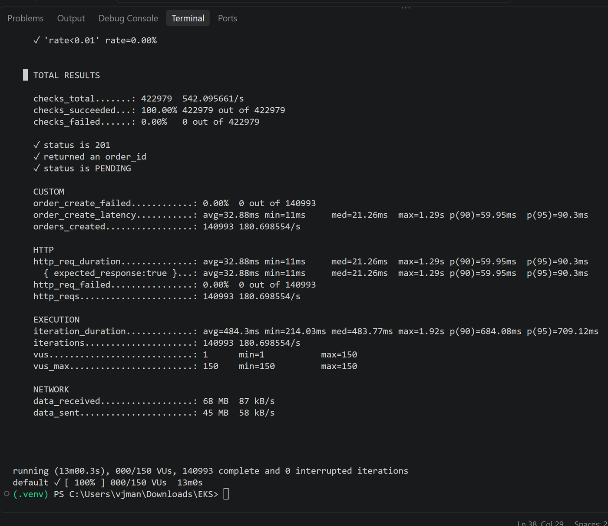
</details>

---

Built by [Vinny Maniscalco](https://www.linkedin.com/in/vinny-maniscalco-291363372) · AWS Certified Solutions Architect – Associate
